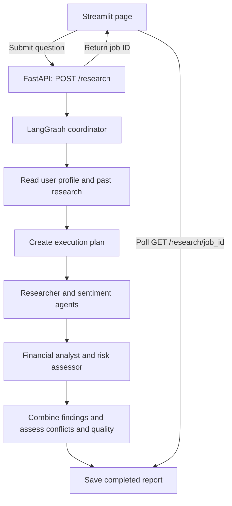

# Understanding this project

This is an AI investment research application. A user asks a question such as
"Compare NVIDIA and AMD's growth prospects and risks." The application searches
for information, runs specialist AI agents, and returns a report with sources,
individual agent findings, and estimated usage costs. It does not place trades.

This guide describes the downloaded copy of
[`07Vaishnavi-Singh/smartfi-agents-system`](https://github.com/07Vaishnavi-Singh/smartfi-agents-system).

## How a question becomes a report



That is the usual fallback plan. The coordinator can change the plan, skip some
information gathering when memory already has relevant results, and replan after
failures. Agents in the same step can run concurrently.

The four agents are different roles and prompts, not necessarily different AI
models. The factory currently supplies them with the same configured model and
shared memory services.

| Agent | Responsibility |
| --- | --- |
| Researcher | Gather facts, financial metrics, and sources. |
| Sentiment | Examine news, analyst opinions, and market mood. |
| Analyst | Interpret financial data, valuation, and growth prospects. |
| Risk assessor | Identify threats, weaknesses, and downside scenarios. |

Agents can plan, search the web through Tavily, search past research, and write
their analysis. The coordinator combines their outputs into the final report.

## Where to read the code

Paths below are relative to the project root.

| Path | What it contains |
| --- | --- |
| `src/investment_research_system/ui/app.py` | Streamlit interface; submits questions and polls for reports. |
| `src/investment_research_system/api/routes.py` | Research submission, job status, health, and user profile endpoints. |
| `src/investment_research_system/api/dependencies.py` | Creates models, memory services, agents, and the coordinator. |
| `src/investment_research_system/orchestrator/graph.py` | LangGraph workflow, planning, and replanning. |
| `src/investment_research_system/orchestrator/tools.py` | Agent dispatch and final report generation. |
| `src/investment_research_system/agents/base.py` | Shared agent execution loop, tool use, retries, and cost controls. |
| `src/investment_research_system/agents/` | The four specialist agents and their prompts. |
| `src/investment_research_system/memory/` | Stores and retrieves past research, facts, and profiles. |
| `src/investment_research_system/models/schemas.py` | Data structures for questions, agent findings, and reports. |
| `src/config.py` | Settings loaded from `.env`. |
| `docker-compose.yml` | Local Redis, Qdrant, and Neo4j services; PostgreSQL is commented out. |
| `tests/` | Existing tests for agents, API, memory, and orchestration. |
| `docs/project-docs/index.html` | Existing detailed project documentation; open in a browser. |

Start with the UI, routes, dependency factory, coordinator, and one specialist
agent, in that order. `main.py` only prints a greeting; it does not start the app.

## Why there are several memory services

| Service | Purpose |
| --- | --- |
| Redis | Temporary session state, job status, budgets, and exact query caching. |
| Qdrant | Similarity search over past research and semantic query caching. |
| Mem0 | Extract and maintain reusable facts from research. |
| Neo4j | Store user profiles and relationships for personalized research. |
| PostgreSQL | Optional record of past sessions and agent decisions. |

`MemoryManager` gives agents one interface to these services. Several operations
handle unavailable backends, but the complete startup path still needs runtime
verification; do not assume every service can be omitted.

## Local setup

The project declares Python 3.13 or newer and uses `uv`. Install those tools and
Docker with Compose before using these commands from the project root:

```sh
uv sync --dev
cp -n .env.example .env
```

Edit `.env` with your own credentials:

- The default model uses Gemini, so it needs `GOOGLE_API_KEY` and access to the
  configured model. Check `src/config.py` for its name.
- Web search uses `TAVILY_API_KEY`.
- Claude models use `ANTHROPIC_API_KEY` if you switch the model configuration.
- `LANGSMITH_API_KEY` is optional and enables tracing.

The Mem0 wrapper configures its embedder but leaves its LLM provider at the
library default. Check that provider's configuration and credentials before
expecting the full application to work with Gemini alone. The local embedding
model may also need to download weights on first use.

Start infrastructure:

```sh
docker compose up -d
```

Start the API in one terminal:

```sh
PYTHONPATH=src uv run uvicorn investment_research_system.api.app:create_app --factory --reload --port 8000
```

Start the interface in another terminal:

```sh
PYTHONPATH=src uv run streamlit run src/investment_research_system/ui/app.py --server.port 8501
```

Open `http://localhost:8501` for the app or `http://localhost:8000/docs` for the API
documentation. These are setup instructions, not a claim that the app has been
run successfully in this workspace.

Run the existing tests after installing dependencies:

```sh
PYTHONPATH=src uv run pytest
```

## Publishing under your GitHub account, SrihithBansal

You can maintain an independent repository without adding the original developer
as a collaborator. Repository ownership, commit authorship, and copyright are
separate things.

At the time this guide was added, this downloaded folder had no `.git` directory.
It therefore contained no previous commit history or configured Git remote to
remove. Initializing Git here would start a new history. This does not change who
wrote the copied code or remove any attribution obligations.

No license file was found in this copy. During the review on 16 November 2026,
GitHub also reported no license for the original repository, and its license
endpoint returned HTTP 404. Establish reuse permission before republishing.
A public GitHub page alone does not grant general permission to redistribute
code. Keep any required copyright notices, license text, and other notices.
Do not add a new license for the copied code unless you have the right to do so.

Once reuse rights are established:

1. Create an empty repository in your GitHub account. Creating a new repository
   instead of using GitHub's Fork action starts an independent repository, but
   it does not change the source code's license requirements.
2. In this folder, initialize Git and set your identity for future commits:

   ```sh
   git init -b main
   git config user.name "YOUR_NAME"
   git config user.email "YOUR_VERIFIED_OR_GITHUB_NOREPLY_EMAIL"
   ```

3. Review the files that would be included. `.gitignore` excludes `.env` files
   while allowing the blank `.env.example` template. Git ignore rules are not a
   secret scanner, so also check that no credentials are embedded in source.

   ```sh
   git status --short --untracked-files=all
   git add .
   git diff --cached --stat
   git diff --cached
   ```

4. After reviewing the staged content, commit it and push to your new repository:

   ```sh
   git commit -m "Initial import"
   git remote add origin https://github.com/SrihithBansal/YOUR_REPOSITORY.git
   git push -u origin main
   ```

Use your own API accounts and credentials to operate the app independently.
The README also contains two images hosted on GitHub attachments; review those
assets and their reuse terms along with the code. A fresh Git history does not
copy GitHub issues, pull requests, stars, or collaborator settings.
